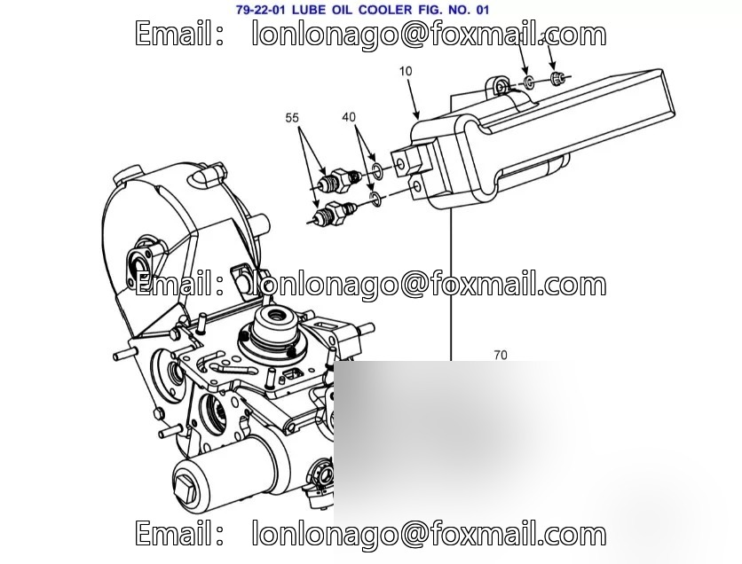
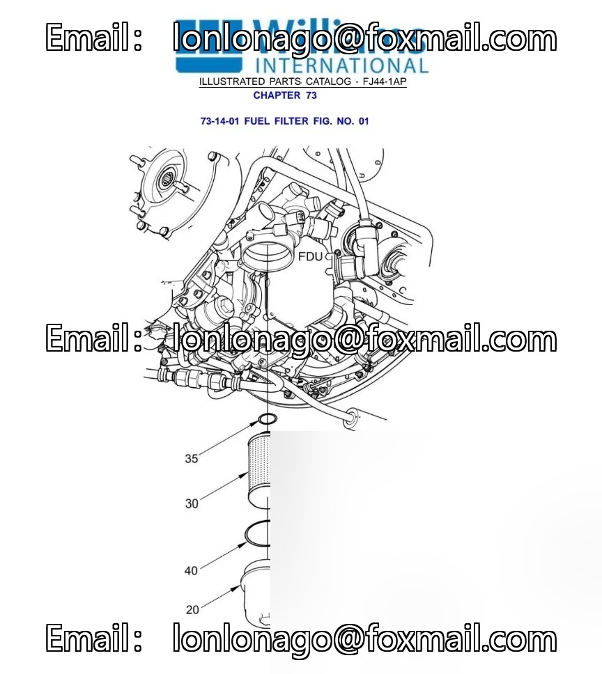
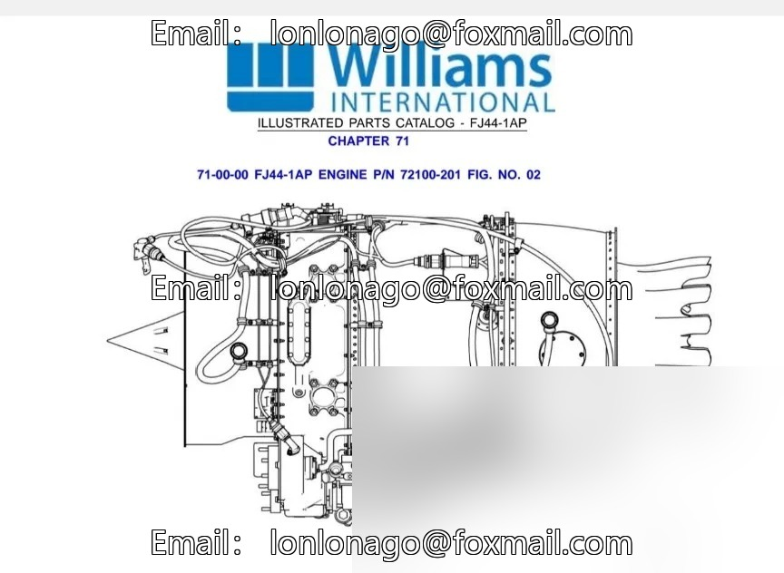

# Williams FJ44-1AP engine diagram

## Body

Williams FJ44-1AP engine diagram; Williams International (Williams International) FJ44-1AP engine diagram parts directory PDF file, 200 pages

Applicable objects: FJ44-1AP (aviation turbofan engine, commonly used as a power device for small/lightly loaded business jets such as previous models of the Falcon 6X or similar levels of business jets/coaching planes, , no return on sale upon issuance)

64491

The documentation includes illustrations of the Williams FJ44-1AP engine and catalog documents covering a LUBE oil cooler and fuel filter, with pages focusing on chapters 73 and 71.

<!-- AI_ENRICHED -->

## Images

## Payment

Here is a pay link on Stripe ( https://buy.stripe.com/3cs8yP7sY87d0vu9AB ). Please contact me lonlonago@foxmail.com after funding $89, and I will send you a complete data files , thank you!

